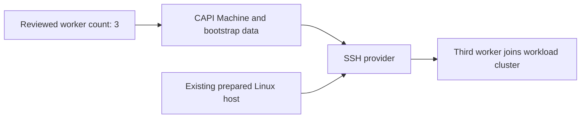

# What the provider does and how you use it

CAPI Provider SSH lets a platform team build and manage Kubernetes clusters on
Linux hosts that already exist. It runs as a controller in a management cluster,
watches Kubernetes resources and executes the infrastructure work over SSH.
Users normally provide reviewed YAML, often through GitOps. They do not import a
Python client into an application to create their nodes.

## Two clusters, two purposes

| Cluster | What runs there | Who uses it |
|---|---|---|
| Management cluster | CAPI core, bootstrap/control-plane controllers, the SSH provider, and the resources describing managed clusters | Platform operators |
| Workload cluster | The Kubernetes nodes represented by CAPI Machines, application pods and jobs | Application teams |

The usual model uses separate management and workload clusters. A self-managed
management cluster requires a deliberately designed bootstrap/pivot procedure;
this provider's installation does not supply automatic adoption or establish
move/pivot support. See the [clusterctl plan](clusterctl-integration.md).

## Who supplies which part?

| Role or component | Supplies / performs | Boundary |
|---|---|---|
| Infrastructure team | VM or physical host, Linux, networking, runtime/package baseline and independently verified SSH identity | The provider does not create VMs or install the OS |
| Platform team | Cluster definition, desired replicas, host inventory and securely delivered credentials/trust | Resource and Secret authors can authorize privileged host execution |
| GitOps controller, when used | Reviewed Kubernetes manifests | Synchronizing manifests does not prove the cluster lifecycle succeeded |
| CAPI core | Cluster/Machine orchestration and higher-level deletion | Delegates infrastructure and bootstrap work |
| Kubeadm bootstrap provider (CABPK) | Bootstrap data, including reviewed kubeadm commands | The SSH provider executes that data; it is not a general package installer |
| Kubeadm control-plane provider (KCP) | Desired control-plane lifecycle and topology | Workload control-plane HA is separate from SSH-controller HA |
| SSH provider | Host assignment, trusted SSH execution, operation observation, status and owned cleanup | Existing-host infrastructure lifecycle |
| Application teams | Applications, workloads and CI jobs | Use Kubernetes; ordinary pods do not call the SSH provider |

Namespaces alone do not isolate mutually untrusted tenants from this controller's
privileges. Read the [security policy](../SECURITY.md) and
[RBAC reference](rbac-requirements.md) before granting resource or Secret access.

## The objects behind a cluster

| Object | Meaning | Normally supplied by |
|---|---|---|
| `SSHHost` | A prepared host offered for pool allocation | Platform team, after host preparation |
| `Cluster` and `SSHCluster` | The desired workload cluster and its infrastructure endpoint | Platform manifests; templates may generate infrastructure objects |
| `KubeadmControlPlane` | Desired control-plane replicas and kubeadm configuration | Platform team |
| `MachineDeployment` | Desired worker count and rollout configuration | Platform team |
| `MachineSet`, `Machine`, `SSHMachine` | The individual node instances and infrastructure lifecycle | CAPI controllers from the reviewed templates |
| `KubeadmConfig` and bootstrap Secret | Instructions for initializing or joining the cluster | CABPK from the reviewed configuration |
| Workload `Node` | The actual registered Kubernetes node | The joining host, in the workload cluster |

The inventory and cluster definition can be delivered separately. An `SSHHost`
by itself does not create a node. A direct-address `SSHMachine` is also supported;
a pool is not mandatory. An isolated infrastructure example is not a complete
workload cluster. See the [API reference](api-reference.md) for exact fields.

## Example: grow from two workers to three

Assume an accepted workload cluster already has two workers and a matching,
prepared spare host is available in its `SSHHost` pool.

1. DevOps changes the worker `MachineDeployment` from `replicas: 2` to
   `replicas: 3` in its reviewed manifests.
2. The manifest owner delivers that change to the management cluster.
3. CAPI creates another Machine and its referenced infrastructure object.
   CABPK generates bootstrap data when the cluster prerequisites are ready.
4. The SSH provider claims the spare host for that Machine UID, verifies SSH
   trust and submits the bootstrap operation under the host lock.
5. The host joins the workload cluster. The provider reports infrastructure
   state; CAPI observes node association and Machine readiness.

This is a conceptual flow, not a complete manifest to apply. If no matching host
is free, increasing replicas cannot create extra hardware or a VM. Diagnose the
allocation and conditions; do not change an existing allocation to another host.

For removal, reduce replicas through CAPI's desired state. CAPI coordinates the
Machine deletion, then the provider performs its owned cleanup. Failed cleanup
retains the claim/finalizer and quarantines the host. Cleanup is not a promise to
erase disks, application data or every CNI/storage artifact. Follow
[operations](operations.md) before reuse across a different trust domain.

## Why a healthy installation can have an empty fleet

Installing controllers is one step. Creating an explicitly managed workload
cluster is another. Existing Nodes in the management cluster are not imported
just because the controllers are running. Application pods and runner pods also
do not appear as CAPI Machines; CAPI describes their underlying managed nodes.
See the [fleet FAQ](faq.md#why-is-the-capi-fleet-empty-even-though-the-controller-is-healthy).

## Continue with an installation

1. Check the [support matrix](support-matrix.md) and [security policy](../SECURITY.md).
2. Use [development](../DEVELOPMENT.md) and the disposable [test lane](testing.md)
   for an isolated evaluation.
3. Follow [installation](installation.md) for the controller and prerequisites.
4. Configure inventory and the full resource chain using the
   [API reference](api-reference.md), then accept a disposable first workload
   through [rollout validation](live-rollout-validation.md).

A Python source/package installation alone does not install the Kubernetes
controller, CRDs or CAPI components. The normal delivery artifact is the
[released container](../CONTAINER_IMAGES.md). There is no stable standalone
end-user console entry point or complete clusterctl release bundle in this source.

Upstream: [CAPI concepts](https://cluster-api.sigs.k8s.io/user/concepts),
[worker scaling](https://cluster-api.sigs.k8s.io/user/guide/lifecycle/scaling).
